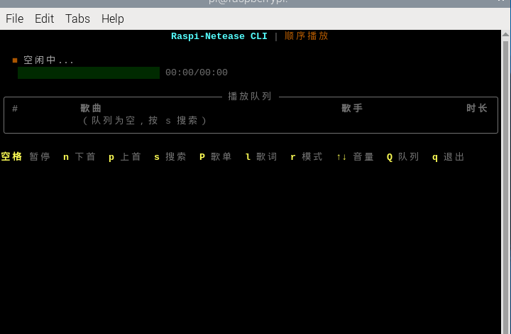

# netease-music-cli

[](LICENSE)
[](https://www.python.org/)
[](#环境要求)
[](https://github.com/laolibuhuifei/netease-music-cli/actions/workflows/ci.yml)

给 **树莓派 Zero 2W（512MB 内存）** 这类低性能设备用的网易云音乐命令行客户端。

跑在终端里，纯键盘操作，内存占用约 70–100MB（含 mpv）。
登录二维码直接画在终端里，不需要浏览器。

> A terminal-based NetEase Cloud Music client for low-end ARM devices
> (tested on Raspberry Pi Zero 2W with 512MB RAM).



---

## 这个项目解决什么问题

想在这类设备上听歌，现成的方案基本都不合适：

- **官方 App / Electron 客户端** —— 512MB 内存根本带不动
- **网页版** —— 开浏览器比听歌还费劲，Zero 2W 上要等到怀疑人生
- **现有的命令行播放器** —— 大多只支持本地文件

所以这里做的是一个纯终端客户端：Python + mpv + rich，没有 GUI、没有浏览器、
没有常驻的 Node 进程。播放交给 mpv（C 写的，CPU 友好），界面用 rich 画在终端里。

## 特性

- **低占用** —— 约 70–100MB（含 mpv），Zero 2W 上可稳定运行
- **终端内扫码登录** —— 二维码用纯 Python 画在终端里，零依赖，不用装 `qrencode`
- **完整播放控制** —— 播放/暂停、上下曲、进度、音量、三种播放模式
- **搜索 / 歌单 / 每日推荐 / 歌词** —— `s` `P` `R` `l` 一键直达
- **无闪烁刷新** —— 备用屏幕 + 内容脏检查，播放时约 1 次/秒，空闲不重绘
- **自动跳过不可播放歌曲** —— 无版权 / 需 VIP 的曲目自动跳到下一首并提示原因
- **本地缓存** —— 歌词、歌曲信息、搜索历史存 SQLite
- **优雅降级** —— 非交互环境自动切纯文本模式，不会因为终端不支持就崩

## 环境要求

| 项目 | 要求 |
| --- | --- |
| 系统 | Raspberry Pi OS / Debian 12（bookworm）或其他 Linux |
| 硬件 | 实测 Raspberry Pi Zero 2W（armv7l, 425MB 可用内存） |
| Python | 3.9+ |
| 播放器 | mpv（`--idle` 模式 + IPC socket 控制） |
| 终端 | 建议 ≥ 80×24，支持 256 色 |

理论上任何能装 mpv 的 Linux 都能跑，不限于树莓派。

## 安装

### 1. 系统依赖

```bash
sudo apt update
sudo apt install -y mpv python3-requests python3-rich python3-pycryptodome
```

> Debian/Raspbian 的 `python3-pycryptodome` 提供的是 `Cryptodome` 命名空间，
> 而 pip 装的是 `Crypto`。代码已做双导入兼容，两种都行。

用 pip 也可以（需要 venv 或 `--break-system-packages`）：

```bash
python3 -m venv ~/.venv-netease
~/.venv-netease/bin/pip install -r requirements.txt
```

### 2. 获取代码

```bash
git clone https://github.com/laolibuhuifei/netease-music-cli.git
cd netease-music-cli
```

### 3. 安装启动器

```bash
chmod +x netease
sudo ln -sf "$PWD/netease" /usr/local/bin/netease
```

也可以不装启动器，直接用 `python3 main.py`。

### 4. 让树莓派有声卡

树莓派默认可能把模拟音频关掉了，表现是 `aplay -l` 只有 `vc4hdmi`，没有
`bcm2835 Headphones`，此时播放进度会一直卡在 0 秒。

```bash
aplay -l
cat /proc/cmdline | tr ' ' '\n' | grep snd_bcm2835
```

如果看到 `snd_bcm2835.enable_headphones=0`，在 `/boot/firmware/cmdline.txt`
**同一行末尾**追加：

```
snd_bcm2835.enable_headphones=1 snd_bcm2835.enable_hdmi=1
```

然后 `sudo reboot`。

`audio_device` 可用值（必须是 mpv 认识的设备名）：
`auto`（默认）、`alsa`、`alsa/sysdefault`、`alsa/hdmi:CARD=vc4hdmi`、`pipewire`、`pulse`。

> ⚠️ **不要写 `default`**。mpv 不认识这个设备名，不会报错，但播放进度会永远停在 0.0 秒。

## 使用

```bash
# 首次使用，扫码登录
netease login

# 搜索并播放
netease search "晴天"

# 查看我的歌单
netease playlist

# 每日推荐
netease recommend

# 按歌曲 ID 播放
netease play 186016

# 交互模式（推荐）
netease
```

> 未登录时只能播放免费歌曲；VIP / 版权歌曲需要登录。不可播放的歌曲会自动跳过并提示原因。

### 登录：二维码直接画在终端里

```
  █▀▀▀▀▀█ ▄█ ▄▄▀▄▄  ▀▀█ █▀█ █▀▀▀▀▀█
  █ ███ █ ▄█▀█ ▄▀█▀▄▄ █▀██▄ █ ███ █
  █ ▀▀▀ █ ▄ █ ▀▄█▄▀▀▀▀▄▀ ▀  █ ▀▀▀ █
  ▀▀▀▀▀▀▀ ▀ ▀ █ █▄█ ▀ ▀▄█ █ ▀▀▀▀▀▀▀
        ...

  用「网易云音乐」App 扫上方二维码
  二维码链接: https://music.163.com/login?codekey=c915515e-...
  扫不了码？把上面的链接复制到手机上打开也能登录
```

手机对着屏幕扫就行，**不需要浏览器，也不需要装 `qrcode` / `qrencode`**。
二维码由 `auth/qrterm.py` 用纯 Python 生成（byte 模式 + 纠错等级 L + 版本 1~10 +
8 种掩码自动择优），只依赖标准库。

终端太矮时静默区会自动从 4 模块缩到 2 模块，保证整块二维码不被截断。

## 交互快捷键

| 键 | 功能 |
| --- | --- |
| `Space` | 暂停 / 播放 |
| `n` / `p` | 下一首 / 上一首 |
| `s` | 搜索（输入时按 `ESC` 取消） |
| `P` | 我的歌单 |
| `R` | 每日推荐 |
| `l` | 歌词 |
| `r` | 切换播放模式（顺序 / 单曲循环 / 随机） |
| `Q` | 查看完整队列 |
| `↑` / `↓` | 音量 ±5 |
| `←` / `→` | 快退 / 快进 5 秒 |
| `ESC` | 返回上级 |
| `q` | 退出 |

## 配置

配置文件：`.config/config.json`（首次运行自动生成）

```json
{
  "cookie": "",
  "music_u": "",
  "quality": "standard",
  "audio_device": "auto",
  "volume": 80.0,
  "play_mode": "order",
  "cache_lyrics": true,
  "cache_covers": false
}
```

| 字段 | 说明 |
| --- | --- |
| `quality` | `standard`(128k) / `higher`(192k) / `exhigh`(320k) / `lossless` |
| `audio_device` | mpv 音频设备名，见上文 |
| `play_mode` | `order` / `repeat-one` / `random` |
| `cache_lyrics` | 是否缓存歌词到 `.cache/lyrics` |

> `.config/` 里存着登录 cookie，**已在 `.gitignore` 中排除，不要提交**。

> 注意：程序退出时会把内存里的状态（如 `play_mode`）写回配置文件。
> 如果想手动改配置，先退出程序再改，否则会被覆盖。

## 常见问题

### 界面一片空白

启动后一片全黑、一个字都没有。实际踩到过三种原因，现已全部处理：

**1. `TERM` 上报异常（`dumb` 或为空）**
rich 对 dumb 终端会直接拒绝渲染，一行都不输出。
程序检测到 `TERM` 异常时会临时改为 `xterm-256color`。

**2. 终端尺寸上报 0×0**
某些 pty（`pty.fork()` 新建的、或窗口刚映射还没同步尺寸的）会报 0 宽 0 高，
rich 遇到 0 尺寸同样什么都不画。程序已兜底成 80×24。

**3. raw 模式把 `OPOST` 关掉了**
这个问题最隐蔽：程序**已经完整渲染了**（日志里能看到 22 行界面），
但屏幕上全黑。原因是 `enable_raw_input()` 里清掉了 `OPOST`，
导致 `\n` 不再被终端翻译成回车换行，rich 输出的每一行都从上一行结尾的
列继续写，整屏"楼梯式"错位，最后被挤出可视区。

正确做法是输入侧照旧 raw，**输出侧保留 `OPOST | ONLCR`**：

```python
mode[tty.OFLAG] |= termios.OPOST | termios.ONLCR   # 不能 &= ~OPOST
```

> 教训：raw 模式只需要改**输入**标志（`ECHO`/`ICANON`/`ISIG`/`IEXTEN`/`IXON`/`ICRNL`）。
> 动 `OPOST` 会破坏所有多行文本输出。

还是空白的话，跑一下诊断：

```bash
netease diag
```

它会打印 TERM、是否 TTY、`console.size`、终端尺寸，并画一个测试方框。

### 播放没声音 / 进度卡在 0 秒

见上文「让树莓派有声卡」。另外确认 `audio_device` 没有写成 `default`。

### 提示「当前不是交互终端」

SSH 默认不分配 tty，程序会切到纯文本模式并提示。用 `-t` 强制分配：

```bash
ssh -t 用户名@设备地址 netease
```

### 终端里打不了中文

程序本身支持 UTF-8 输入，但需要在系统层面装中文输入法。树莓派桌面（Wayland
labwc 或 X11）上用 fcitx 即可，配置样例见 [`deploy/`](deploy/)。

快捷键：`Ctrl+Space` 切换中英文。

> 注意：Raspberry Pi OS bookworm 的 armhf 仓库里 `fcitx5-pinyin` 没有构建，
> 只能用 fcitx4。详见 [`deploy/README.md`](deploy/README.md)。

### 界面闪烁

已用备用屏幕缓冲区 + 内容脏检查解决。若某些终端对 alternate screen 支持不佳：

```bash
NETEASE_PLAIN=1 netease
```

## 项目结构

```
netease-music-cli/
├── main.py              # 入口：CLI 子命令分发 + 交互主循环
├── config.py            # 配置读写
├── netease              # 启动器脚本（TERM 兜底等）
├── api/
│   ├── crypto.py        # weapi 加密（AES-128-CBC ×2 + RSA）
│   └── client.py        # 网易云 API 封装
├── auth/
│   ├── login.py         # 扫码 / 手机号登录
│   └── qrterm.py        # 零依赖二维码生成 + 终端渲染
├── player/
│   ├── mpv_wrapper.py   # mpv IPC 控制
│   └── queue.py         # 播放队列与播放模式
├── ui/
│   └── tui.py           # rich 终端界面 + raw 模式键盘输入
├── cache/
│   ├── db.py            # SQLite 缓存
│   └── FileManager.py   # LRC 文件缓存
├── tests/               # 单元测试 / 端到端测试
├── tools/               # 诊断与部署验证脚本
├── deploy/              # 树莓派系统侧配置（中文输入法等）
└── docs/screenshots/    # 截图
```

## 开发

### 跑测试

```bash
# 单元测试（不联网、无第三方依赖，CI 里跑的就是这个）
python3 -m unittest discover -s tests -v

# 端到端测试：自建 pty，验证按键、重绘频率、中文输入搜索
python3 tests/test_tui_keys.py
```

### 诊断工具

```bash
# 打印终端环境并画测试方框
python3 main.py diag

# 在不同 TERM / 尺寸下批量检查渲染
python3 tools/diag_terminal.py

# 部署全链路验证（依赖 / 模块 / API / 缓存 / mpv / 真实播放）
python3 tools/verify_deploy.py
```

> 端到端测试和诊断工具都依赖真实 pty 与网络，不适合放进 CI。

### 代码风格

```bash
pip install ruff
ruff check .
```

## 已知限制

- 播放控制依赖 mpv 的 IPC socket，同一时间只支持一个实例
- 未做多音源切换，只对接网易云
- 歌词仅支持 LRC 格式，不做逐字滚动
- 树莓派 Zero 2W 上 320k / 无损音质中文档较大，建议 `standard` 或 `higher`

## 贡献

欢迎提 Issue / PR，详见 [CONTRIBUTING.md](CONTRIBUTING.md)。

## 免责声明

- 本项目为个人学习与技术研究用途，**非网易官方客户端**。
- 所有音乐版权归网易云音乐及各版权方所有，本项目**不提供、不存储、不分发**
  任何音频内容，仅调用公开接口。
- 逆向得到的接口随时可能变更或失效，由此导致的不可用属正常情况。
- 请勿将本项目用于商业用途。因使用本项目产生的任何后果由使用者自行承担。

## 许可证

[MIT License](LICENSE) © 2026 [laolibuhuifei](https://github.com/laolibuhuifei)
