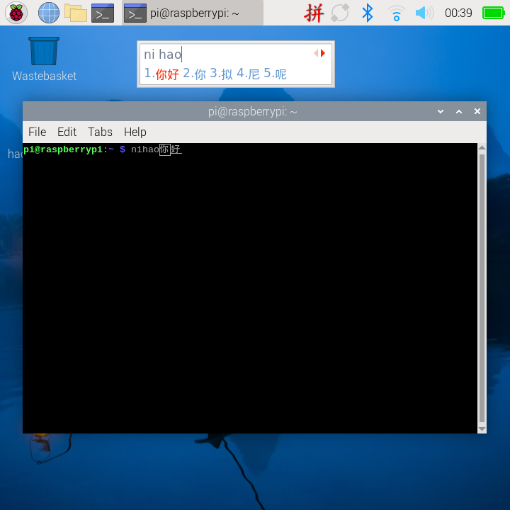

# deploy

树莓派系统侧的配置样例，跟程序本身无关，但在这类设备上往往是用起来的前提。

## 中文输入法（fcitx4）

在终端里用 `s` 搜中文歌名，需要系统层面装中文输入法。本目录是实测可用的配置。

### 为什么是 fcitx4 不是 fcitx5

Raspberry Pi OS（bookworm）的 **armhf 仓库里 `fcitx5-pinyin` / `fcitx5-table` /
`fcitx5-chinese-addons-bin` 没有构建**，导致 `fcitx5-chinese-addons`
依赖不可满足、装不上。fcitx4 全栈在 armhf 上是完整的，而且更省内存
（Zero 2W 只有 512MB）。

```bash
sudo apt install -y fcitx fcitx-bin fcitx-pinyin fcitx-googlepinyin \
    fcitx-frontend-gtk2 fcitx-frontend-gtk3 fcitx-frontend-qt5 fcitx-frontend-qt6 \
    fcitx-config-gtk fcitx-module-dbus fcitx-module-kimpanel fcitx-module-lua \
    fcitx-module-x11 fcitx-ui-classic
```

### 文件说明

| 文件 | 目标位置 | 作用 |
| --- | --- | --- |
| `fcitx_profile` | `~/.config/fcitx/profile` | 启用的输入法列表 |
| `fcitx_autostart.desktop` | `~/.config/autostart/fcitx.desktop` | 登录自启 |
| `labwc_environment` | `~/.config/labwc/environment` | Wayland 会话的环境变量 |
| `fcitx_xprofile` | `~/.xprofile` | X11 会话的环境变量 |
| `etc_environment` | `/etc/environment` | PAM 兜底（需 sudo） |

安装：

```bash
mkdir -p ~/.config/fcitx ~/.config/autostart ~/.config/labwc
cp fcitx_profile          ~/.config/fcitx/profile
cp fcitx_autostart.desktop ~/.config/autostart/fcitx.desktop
cp labwc_environment      ~/.config/labwc/environment
cp fcitx_xprofile         ~/.xprofile
sudo cp etc_environment /etc/environment   # 注意：会覆盖现有内容，先备份
```

然后重启（或重新登录）。

### 用法

| 操作 | 按键 |
| --- | --- |
| 中英文切换 | `Ctrl` + `Space` |
| 选词 | 数字 `1`~`5`，空格选第一个 |
| 候选翻页 | `-` / `=` |
| 切换输入法 | `Ctrl` + `Shift` |

面板右上角出现「拼」表示中文模式，键盘图标表示英文模式。



### 几个坑

**1. profile 的键名必须是 `EnabledIMList`**

```ini
[Profile]
FirstInputMethod=fcitx-keyboard-us
LastBuiltinLayout=us
IMNameList=fcitx-keyboard-us,fcitx-pinyin
EnabledIMList=fcitx-keyboard-us:True,fcitx-pinyin:True
```

写成 `EnableIMList`（少个 d）会让 `fcitx-diagnose` 报 "Found 0 enabled input methods"。
值的格式也必须是 `名字:True` 或 `名字:False`，逗号分隔。

**2. 改 profile 前先停掉 fcitx**

```bash
pkill -x fcitx    # 不要用 pkill -f fcitx，会把自己那条命令一起杀掉
```

否则 fcitx 退出时会把内存里的旧配置写回去，白改。

**3. lxterminal 是单实例的**

新开窗口会复用老进程的环境变量。改完 `GTK_IM_MODULE` 之类必须**整体重启
lxterminal**（`pkill -x lxterminal`），否则新窗口拿不到变量，输入法不生效。

**4. 不要自建 `~/.config/labwc/autostart`**

labwc 的系统级 autostart 里已经有 `lxsession-xdg-autostart`，
它会执行 `~/.config/autostart/*.desktop`。自己新建 labwc 的 autostart
有可能覆盖系统那份，导致面板/桌面不启动。

### 已知限制

Wayland（labwc）下 fcitx4 没有原生前端，候选框靠 Xwayland 渲染，
所以**候选框固定显示在窗口左上方，不跟随光标**。打字本身完全正常。

想要候选框跟随光标，可以把桌面会话切回 X11：

```bash
sudo nano /etc/lightdm/lightdm.conf
# autologin-session=LXDE-pi-labwc  →  LXDE-pi-x
```

### 排错

```bash
fcitx-diagnose | grep -A5 "Input Methods"   # 应显示 2 个已启用输入法
fcitx-remote                                 # 打印 1=英文模式 2=中文模式
```
